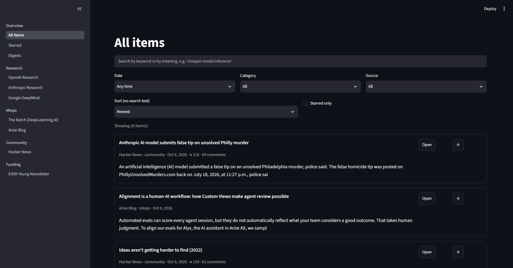

# AI NEWSPOST
Personal, local-only AI news system.

### Sources
Hacker News (AI posts), The Batch (DeepLearning.AI, weekly), Arize blog, frontier lab research pages (OpenAI, Anthropic, DeepMind, etc.), Edith Yeung's weekly newsletter (startup funding).



## Setup Commands
```sh
uv sync

uv run playwright install chromium 

docker compose up -d

uv run pytest -q

uv run runner.py
```

---

## Other Commands

### Check that the db container is up and the schema was applied.
docker exec -it ai-digest-db psql -U digest -d digest -c "\dt"

### Check config file
uv run python -c "from digest.config import load_sources; print(load_sources())"

### Check that db file
uv run python -c "from digest import db; c = db.connect(); print(c.execute('select count(*) from items').fetchone()); c.close()"

### Check LLm file
uv run python -c "from digest import llm; v=llm.embed_one('hello'); print(len(v)); print(llm.usage_report())"

### Check HN
uv run python -c "from digest.config import load_sources; from digest.ingest import hn; src=[s for s in load_sources() if s['id']=='hn'][0]; items=hn.fetch(src); print(len(items)); [print(i['points'], i['title']) for i in items[:5]]"

### Check HN+DB
uv run python -c "from digest import db; from digest.config import load_sources; from digest.ingest import hn; src=[s for s in load_sources() if s['id']=='hn'][0]; items=hn.fetch(src); c=db.connect(); db.sync_sources(c, load_sources()); n=sum(1 for i in items if db.insert_item(c,i)); db.record_fetch(c,'hn','ok',len(items)); c.commit(); c.close(); print(n,'saved')"

### Test Feed Sources
uv run python -c "import feedparser; [print(u, '|', len((d:=feedparser.parse(u)).entries), 'entries | status', d.get('status'), '|', d.get('bozo_exception')) for u in ['https://openai.com/news/rss.xml','https://deepmind.google/blog/feed/basic/','https://edithyeung.substack.com/feed','https://arize.com/blog/feed/']]"

### Check RSS+DB
uv run python -c "from digest import db; from digest.config import load_sources; from digest.ingest import rss; c=db.connect(); db.sync_sources(c, load_sources(include_todo=True)); [print(s['id'], sum(1 for i in rss.fetch(s) if db.insert_item(c,i)), 'saved') for s in load_sources() if s['type']=='rss']; c.commit(); c.close()"

### Check Extraction
uv run python -c "from digest import db, extract; c=db.connect(); print(extract.extract_pending(c)); c.commit(); c.close()"

### Check Extraction Docker
docker exec -it ai-digest-db psql -U digest -d digest -c "select source_id, count(*) filter (where content <> '') as with_text, count(*) filter (where content = '') as empty, count(*) filter (where content is null) as pending from items group by 1"

### Check Empty items in DB
docker exec -it ai-digest-db psql -U digest -d digest -c "select url from items where content = ''"


### Check AI Clustering
#### with llm usage reporting
uv run python -c "from digest import db, dedup, llm; c=db.connect(); print(dedup.embed_pending(c)); print(dedup.cluster_new_items(c)); c.commit(); c.close(); print(llm.usage_report())"

#### without llm usage reporting
uv run python -c "from digest import db, dedup; c=db.connect(); print(dedup.embed_pending(c)); print(dedup.cluster_new_items(c)); c.commit(); c.close()"

### View merged clusters
docker exec -it ai-digest-db psql -U digest -d digest -c "select cluster_id, count(*) n, string_agg(left(title,40), ' | ') from items group by 1 having count(*)>1"


### Check Closest Pairs
docker exec -it ai-digest-db psql -U digest -d digest -c "select round((1-(a.title_embedding<=>b.title_embedding))::numeric,3) sim, left(a.title,45) a, left(b.title,45) b from items a join items b on a.id<b.id order by a.title_embedding<=>b.title_embedding limit 8"

uv run tmp_titles.py

### Perform Recluster
docker exec -it ai-digest-db psql -U digest -d digest -c "update items set cluster_id=null"

### Check Search
uv run python -c "from digest import db, search; c=db.connect(); [print(round(r['score'],4), r['source_id'], r['title'][:60]) for r in search.search(c,'agent evaluation')]; c.close()"

## Check Ranking (prefilter)
uv run python -c "from digest import db, rank; c=db.connect(); [print(round(r['score'],3), round(r['sim'],3), r['source_id'], r['title'][:60]) for r in rank.prefilter(c, since_hours=720)]; c.close()"

## Check Ranking Select (LLM)
uv run python -c "from digest import db, rank; c=db.connect(); [print(p['id'], p['reason']) for p in rank.select(c, since_hours=720)]; c.close()"

## Check Pipeline DRY RUN (no PDF, no summary)
uv run python -c "from digest import pipeline; r=pipeline.run(dry_run=True); [print(p['id'], p['title'][:60], '|', p['reason']) for p in r['picks']]; print(r['note']); [print(s) for s in r['sources']]"

## Check Full Run
uv run python -m digest run

## Check Full Run Rebuild
uv run python -m digest run --force       rebuild today's digest

## Check Partial Runs
uv run python -m digest run --dry-run     picks only, no summaries, no PDF
uv run python -m digest run --no-fetch    skip fetching

## Check PDF generation
uv run python -m digest.pdf

## Check Scraping
uv run python -c "from digest.config import get_source; from digest.ingest import scrape; [print(i['published_at'].date() if i['published_at'] else None, i['title'][:70], '|', i['url']) for s in ('the_batch','anthropic') for i in scrape.fetch(get_source(s))]" 

uv run python -c "from digest.config import get_source; from digest.ingest import scrape; [print(i['published_at'].date(), i['title'][:60], '|', i['canonical_url']) for i in scrape.fetch(get_source('techgig_et'))]"